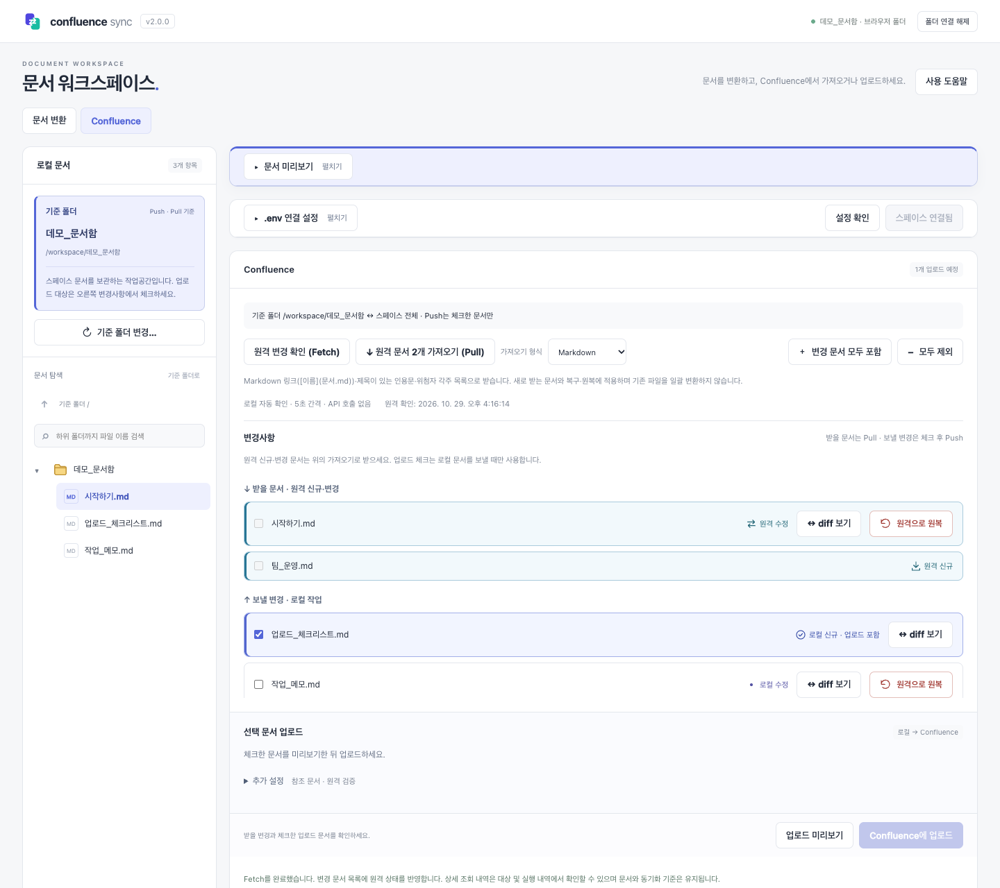

# confluence-sync

**Confluence Cloud와 로컬 Markdown을 CLI·웹으로 가져오고 업로드합니다.**

- **Fetch**: 원격 문서의 신규·버전·위치 변경을 확인합니다.
- **Pull**: 받을 원격 문서를 로컬 폴더에 반영합니다.
- **Push**: 직접 선택한 로컬 문서만 Confluence에 업로드합니다.

Obsidian의 위키링크·콜아웃·각주와 이미지·PDF 첨부도 지원합니다.

## 웹으로 시작하기

**[웹 열기](https://confluence-sync-six.vercel.app/)** · CLI 설치 없이 데스크톱 Chrome·Edge에서 사용합니다.

1. **문서 폴더 열기**로 로컬 문서 폴더를 선택하고 읽기·쓰기 권한을 허용합니다.
2. **Confluence → .env 연결 설정**에서 설정 파일을 선택합니다. 샘플 다운로드와 API 토큰 발급 가이드를 제공하며, 처음 사용하는 폴더는 **스페이스 연결**을 누릅니다.
3. **Fetch → Pull**로 원격 문서를 확인하고 가져옵니다.
4. 보낼 문서만 체크한 뒤 **업로드 미리보기 → Confluence에 업로드**를 누릅니다.

문서 미리보기·표 서식 정리·변환도 웹에서 할 수 있습니다. [화면과 자세한 웹 사용법](docs/user/WEB.md)

<details>
<summary>웹 화면 보기</summary>

예시 문서와 Confluence 데이터를 사용한 화면입니다.



</details>

## CLI로 시작하기

Node.js 22.13 이상인 22.x 또는 24.x가 필요합니다.

```bash
npm i -g @wonseok-han/confluence-sync
mkdir my-docs
cd my-docs
csync init                  # 안내에 따라 .env에 연결 정보 입력
csync pull                  # 스페이스 문서를 현재 폴더로 가져오기
```

API 토큰과 스페이스 키 준비는 [연결 설정 가이드](docs/user/CONFIGURATION.md#api-토큰-발급)를 참고하세요. 기존 문서 폴더를 먼저 연결하려면 `csync init --connect --base <폴더>`를 사용합니다.

평소에는 원격을 확인하고, 편집한 문서만 선택해 업로드합니다.

```bash
csync fetch
csync status
csync pull
# 로컬 문서 편집 후
csync diff "가이드.md"
csync add "가이드.md"
csync push --dry-run --verify
csync push
```

**Push는 add한 문서만 업로드합니다.** 기본 Pull은 로컬 수정·양쪽 변경을 보존하며, 로컬에서 파일을 삭제해도 원격 페이지를 삭제하지 않습니다. 연결과 매핑·선택 정보는 문서 폴더의 `.env`와 `.csync/`에 보관합니다.

로컬 웹을 쓰려면 `csync web --base .`를 실행하세요. `csync`는 도움말만 표시하며, 명령별 옵션은 `csync <명령> --help`로 확인합니다.

## 필요한 설명 찾기

| 궁금한 내용 | 문서 |
| --- | --- |
| 명령별 옵션, 문서 선택·복구·이동, 제외 규칙 | [CLI 사용 안내](docs/user/CLI.md) |
| 웹 화면, .env 가져오기, 문서 미리보기·표 편집 | [웹 사용 안내](docs/user/WEB.md) |
| API 토큰, 작업공간 구조, v1에서 이전 | [설정과 작업공간](docs/user/CONFIGURATION.md) |
| 위키링크·콜아웃·각주·PDF, convert 사용법 | [Obsidian과 문서 변환](docs/user/OBSIDIAN.md) |

버그 신고는 [GitHub Issues](https://github.com/wonseok-han/confluence-sync/issues), 개발·테스트는 [기여 안내](CONTRIBUTING.md), 버전별 변경은 [CHANGELOG](CHANGELOG.md)를 참고하세요.

[MIT License](LICENSE)
