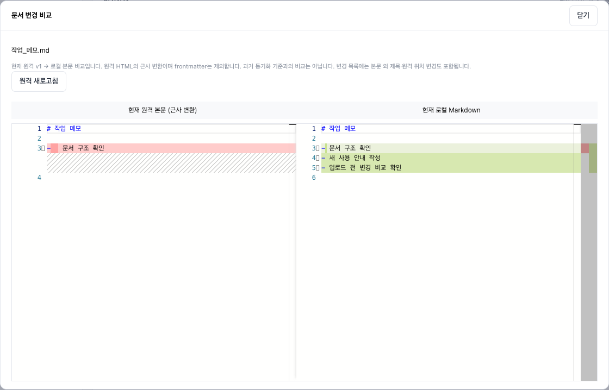
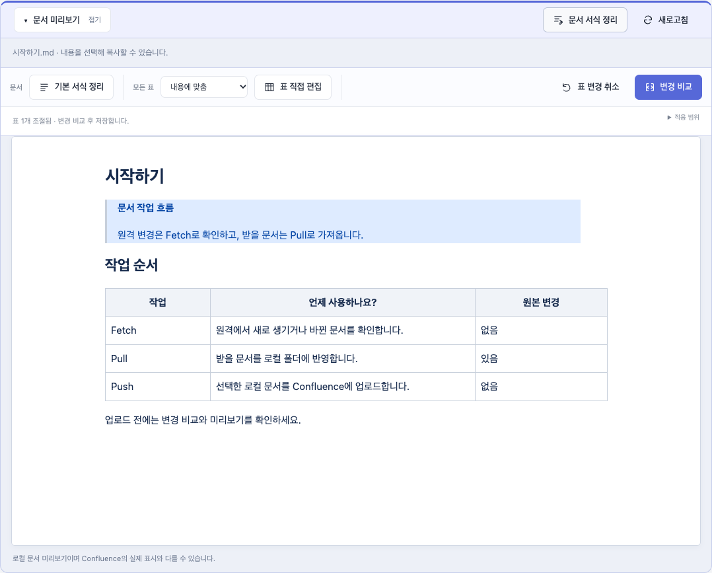

# 웹 사용 안내

[← README로 돌아가기](../../README.md)

브라우저에서 문서 폴더를 연결하고, 변경사항과 미리보기를 확인하며 작업하는 방법입니다.

- [웹에서 변환·동기화하기](#웹에서-변환동기화하기)
- [브라우저에서 문서 폴더 열기](#브라우저에서-문서-폴더-열기)
- [문서 전체 서식 정리](#문서-전체-서식-정리)
- [표 서식 편집](#표-서식-편집)
- [Confluence: 업로드(Push)와 가져오기(Pull)](#confluence-업로드push와-가져오기pull)

## 웹에서 변환·동기화하기

**[웹 열기](https://confluence-sync-six.vercel.app/)** — CLI 설치 없이 브라우저에서 로컬 문서 폴더를 열어 변환·Fetch·Pull·Push를 사용할 수 있습니다. 데스크톱 Chrome·Edge에서 폴더의 읽기·쓰기 권한을 허용하세요. 직접 로컬 웹을 실행하려면 아래 명령을 사용합니다.

화면 상단의 **사용 도움말**에서 변환·동기화 순서, 참조 링크, 덮어쓰기와 로그 설명을 확인할 수 있습니다. **화면으로 보기**에서는 작업별 캡처를 펼치고 원본 크기로 열 수 있습니다.

```bash
csync web                         # 홈 폴더에서 시작, 브라우저 자동 열기
csync web --base ~/Documents       # 원하는 폴더에서 시작
```

1. 왼쪽 **로컬 문서**의 **기준 폴더 변경…**으로 시스템 폴더 다이얼로그를 열어 Vault나 문서 묶음의 기준 폴더를 지정합니다. **경로를 직접 입력해 변경**을 펼치고 **이 폴더를 기준으로 설정**을 눌러도 됩니다. 기준 폴더 카드에는 실제 적용된 이름과 전체 경로가 표시됩니다. 아래 **문서 탐색**은 상대 위치를 표시하며, 하위 폴더를 열어도 기준 폴더는 바뀌지 않습니다. **기준 폴더로** 버튼으로 돌아갈 수 있습니다.
2. 파일 이름을 검색하면 기준 폴더의 모든 하위 폴더에서 `.md` 문서를 찾고 상대 경로를 함께 표시합니다. 검색어를 지우면 현재 폴더 목록으로 돌아갑니다. 문서 트리에서 폴더 옆 화살표는 하위 항목을 펼치거나 접고, 폴더·파일 이름은 변환 대상을 선택합니다. 폴더 이름을 선택하면 하위 Markdown 전체, 파일 이름을 선택하면 그 문서 하나가 대상입니다. 펼침·접기는 선택한 대상을 바꾸지 않습니다.
3. **출력 폴더 선택…**으로 저장 위치를 지정합니다. 새 폴더 경로를 입력할 수도 있으며, 비워두면 기준 폴더 옆에 `폴더명-converted-XXXXXX`를 만듭니다.
4. **문서 미리보기**는 기본적으로 접혀 있습니다. `.md` 파일을 선택하고 **문서 미리보기 · 펼치기**를 누르면 본문이 표시됩니다. 접힌 동안에는 문서 렌더링 요청을 보내지 않습니다. HTML 표의 너비·병합 셀과 기준 폴더 안의 로컬 이미지도 표시하며, 내용을 선택해 복사할 수 있습니다. 파일을 외부에서 수정한 뒤에는 미리보기의 **새로고침**을 누르세요. 변환·동기화 탭 모두에서 사용할 수 있습니다.
5. **변환 미리보기**를 누르면 본문 비교 화면에 삭제·추가된 부분이 색상으로 표시됩니다. 나란히/인라인 비교와 이전·다음 변경 이동을 지원합니다.
6. **변환 후 저장**을 누르고 **결과 폴더 열기**로 확인합니다.

웹에서 파일 하나를 선택하면 출력 폴더 바로 아래에 저장합니다. 폴더 전체를 선택하면 모든 하위 Markdown을 변환하고, 선택한 폴더 내부의 상대 경로만 출력 폴더 아래에 유지합니다. 링크 해석 기준은 단일 파일의 부모 폴더 또는 선택한 폴더입니다. CLI의 `--base` 동작은 그대로입니다. 출력 폴더를 기준 폴더와 같게 지정하면 선택한 문서·첨부의 원래 위치에 저장합니다. 하위 폴더나 파일을 선택했다면 그 범위만 반영하며 기준 폴더 바로 아래로 옮기지 않습니다. 다른 형태로 겹치는 출력 경로는 거부하며, 기존 출력 파일과 내용이 같으면 재사용하므로 같은 폴더에 연속 저장할 수 있습니다. 이름은 같지만 내용이 다르면 대상 파일 목록을 보여주고 덮어쓸지 확인합니다. 취소하면 저장하지 않으며, 확인한 기존 파일이 변경되면 다시 확인합니다. 원본 덮어쓰기는 확인 후 원본이 수정·삭제되면 저장을 중단하므로 미리보기부터 다시 진행하세요. **다른 문서 선택**을 누르면 기준 폴더와 변환 설정을 유지한 채 다음 문서를 고를 수 있습니다. 선택한 대상의 문서와 참조 첨부를 내보냅니다. 단일 파일 모드에서는 링크로 참조된 다른 문서를 함께 복사하지 않습니다. 폴더 변환의 본문 비교는 최대 20개 문서(문서당 200KB 이하)를 선택해서 확인하며, 실제 저장은 전체 문서에 적용됩니다.

변환 미리보기는 원본 파일을 변경하지 않습니다. 로컬 웹에서 폴더 선택창을 사용할 수 없는 환경에서는 경로를 직접 입력할 수 있습니다. Linux에서 로컬 폴더 선택창을 사용하려면 `zenity`가 필요합니다.

웹은 `http://localhost:4318` 또는 `http://127.0.0.1:4318`에서 열 수 있습니다. 두 주소의 브라우저 저장소는 별개이므로 기존 경로 설정을 유지하려면 같은 주소로 접속하세요. 변환과 동기화 미리보기는 Confluence 인증 없이 사용할 수 있습니다. 이 문단의 `csync web`은 개인용 로컬 실행 방식입니다. 설치 없이 사용하는 웹은 아래의 **브라우저에서 문서 폴더 열기**를 참고하세요. `--port 4320`으로 포트를 바꾸거나 `--no-open`으로 자동 열기를 끌 수 있습니다. 종료는 터미널에서 `Ctrl+C`입니다.

변환 설정의 **기준 폴더 전체 선택**을 누르면 기준 폴더와 모든 하위 폴더의 Markdown을 한 번에 변환할 수 있습니다. 탐색 중인 하위 폴더나 선택 파일과 관계없이 기준 폴더 전체를 선택합니다. 선택 후 **변환 미리보기 → 변환 후 저장**을 사용하며 결과는 지정한 출력 폴더에 저장합니다. 출력 경로가 원본과 같으면 저장 시 확인창을 띄우고, 확인 후 원래 위치에 반영합니다. CLI에서는 `csync convert --to markdown --base ./vault --out ./markdown`처럼 기준 폴더만 지정하면 전체를 처리합니다.

### 브라우저에서 문서 폴더 열기

설치 없이 사용하는 웹에서는 **문서 폴더 열기**로 Vault나 문서 폴더를 선택하고 읽기·쓰기 권한을 허용합니다. 데스크톱 Chrome·Edge와 HTTPS가 필요합니다.

1. **문서 폴더 열기**로 Vault나 문서 폴더를 선택합니다. 왼쪽 **기준 폴더**에서 현재 연결된 폴더를 확인합니다.
2. **Confluence** 탭에서 **.env 연결 설정**을 펼칩니다. 기준 폴더의 `.env`를 읽거나 **.env 가져오기**로 연결 정보를 설정하세요. **.env 샘플 다운로드**와 **API 토큰 발급 가이드**도 제공하며, 처음 사용하는 폴더라면 **스페이스 연결**을 누릅니다.
3. **원격 변경 확인 (Fetch)**을 눌러 새 문서와 버전·위치 변경을 확인합니다. 로컬 변경은 자동으로 검사하며, 받을 문서와 보낼 변경을 나눠 표시합니다.
4. 원격에서만 바뀐 문서는 **원격 문서 n개 가져오기 (Pull)**로 받습니다. **가져오기 형식**에서 Markdown 또는 Obsidian을 선택할 수 있습니다. 양쪽에서 수정된 문서는 비교하거나 명시적으로 원격 복구를 선택하세요.
5. 업로드할 문서만 체크하고 **업로드 미리보기 → Confluence에 업로드** 순서로 진행합니다. 미리보기를 완료해야 업로드 버튼이 활성화됩니다. 체크하지 않은 문서는 업로드하지 않습니다.
6. 문서 변환은 **문서 변환** 탭에서 대상과 출력 폴더를 고른 뒤 **변환 미리보기 → 변환 후 저장**을 사용합니다. 작업 중에는 탭을 열어 두세요. 로컬 편집과 충돌하면 **로컬 파일 적용 확인**의 안내를 확인합니다.

아래 화면의 문서와 Confluence 데이터는 사용법 설명용 예시입니다. 받을 문서와 보낼 변경이 구분되며, 체크한 항목만 업로드합니다.


문서의 **diff 보기**를 누르면 현재 원격 본문을 조회해 로컬 Markdown과 비교합니다. 왼쪽은 원격 HTML의 근사 변환본이고 오른쪽은 로컬 본문입니다. 제목·위치·버전 변경은 변경사항 목록에서도 확인하세요.



참조 폴더는 읽기 전용이며, 원본 덮어쓰기는 확인 후 적용합니다. 문서 처리 위치와 서버로 전송되는 정보는 사용하는 웹의 안내에서 확인하세요.

### 문서 전체 서식 정리

`.md` 파일을 선택하고 **문서 미리보기 → 문서 서식 정리**를 누릅니다. **기본 서식 정리** 버튼을 누르면 정리 결과를 바로 비교합니다. 제목·문단 간격, 목록 기호, 줄 끝 공백, 마지막 줄바꿈과 Markdown 표 정렬을 통일합니다. 코드·frontmatter·링크 경로는 유지하며, 명확한 일반 텍스트의 불필요한 이스케이프만 보정합니다. 의미가 바뀔 수 있는 들여쓰기와 번호 값은 유지합니다.

서식 툴바의 **모든 표**는 기본적으로 **기존 너비 유지**입니다. **내용에 맞춤** 또는 **균등 배분**을 선택하면 편집 가능한 모든 표에 기존 전체 너비를 유지한 채 적용합니다. 이후 **표 직접 편집**으로 개별 표를 추가 조절할 수 있습니다. 너비를 지정한 Markdown 표는 HTML로 변환하며 기존 HTML 표의 병합 셀은 보존합니다. 중첩·목록 안의 표는 일괄 너비 편집에서 제외합니다.

**변경 비교 → 원본 파일에 저장**으로 반영합니다. 비교창을 닫으면 저장하지 않으며, 원본이 외부에서 바뀌었다면 저장을 중단합니다. 미저장 표 너비 변경이 있다면 기본 서식 정리 결과와 함께 비교·저장합니다. 표만 조절하려면 오른쪽 변경 비교를 사용하세요.



### 표 서식 편집

1. `.md` 파일을 선택하고 **문서 미리보기 → 문서 서식 정리**를 엽니다. 툴바는 문서 기본 서식, 모든 표 너비, 표 직접 편집과 변경 비교로 묶여 있습니다.
2. **모든 표**에서 내용에 맞춤·균등 배분을 고르면 표 선택 없이 일괄 적용됩니다. 한글 등 넓은 문자와 병합 셀을 고려하며 기존 전체 너비를 유지합니다.
3. **표 직접 편집**을 누르고 미리보기에서 표를 클릭하면 아래에 해당 표 조절 도구가 표시됩니다. 열 경계 드래그·내용에 맞춤·균등 배분·표 너비 슬라이더로 조절할 수 있습니다.
4. 오른쪽 **변경 비교**로 표 변경만 확인하거나 **기본 서식 정리**로 본문 정리까지 함께 확인한 뒤 **원본 파일에 저장**합니다.

저장 전 변경은 화면에만 적용됩니다. **선택 표 취소**는 선택한 표만, 툴바의 **표 변경 취소**는 미저장 표 너비 변경 전체를 되돌립니다. 문서 서식 정리를 접어도 변경은 유지하지만, 파일을 바꾸거나 미리보기를 새로고침하면 취소됩니다. 외부에서 파일이 수정되었다면 덮어쓰지 않고 다시 읽도록 안내합니다.

일반 Markdown 표는 너비를 저장하기 위해 해당 표만 HTML로 변환합니다. 기존 HTML 표는 셀 내용과 `colspan`·`rowspan`을 보존하며, 문서의 나머지 부분은 유지합니다. 현재는 픽셀 너비를 저장하고 열당 최소 40px·전체 최대 3000px를 지원합니다. 중첩 표와 목록 안의 표 등 원본 위치를 안전하게 대응할 수 없는 표는 편집하지 않습니다. 문서 전체의 소스 서식은 위의 **문서 서식 정리**에서 처리합니다.

### Confluence: 업로드(Push)와 가져오기(Pull)

1. 왼쪽에서 기준 폴더를 열고 **Confluence** 탭을 선택합니다.
2. **.env 연결 설정**에서 설정을 확인하고 **스페이스 연결**을 누릅니다. 기준 폴더가 스페이스 작업공간이 되며 문서 탐색은 미리보기용으로 사용합니다.
3. **업로드(Push)**에서는 미리보기에서 선택 범위의 신규·변경·이동과 링크 경고를 확인한 뒤 업로드합니다. 원격 확인을 선택하면 미리보기에서도 읽기 전용으로 원격 버전을 확인합니다.
4. **가져오기(Pull)**는 아직 받지 않은 원격 문서와 원격에서만 바뀐 문서를 받습니다. 로컬 수정·의도적인 삭제·양쪽 변경은 보존합니다.

로컬 문서에서 미리보기할 문서를 바꿔도 업로드 선택은 바뀌지 않습니다. 변경사항 목록에서 체크한 문서만 Push합니다.

연결 정보와 토큰 권한은 [설정 가이드](CONFIGURATION.md#api-토큰-발급)를 참고하세요.
